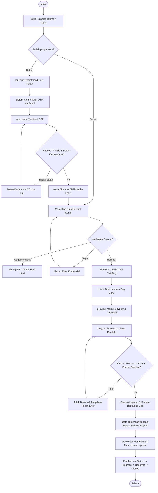
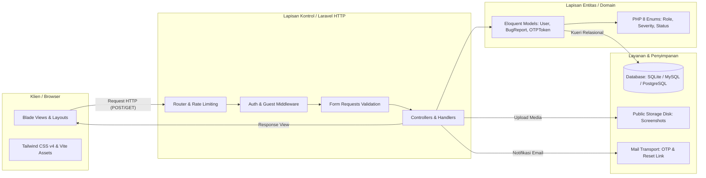
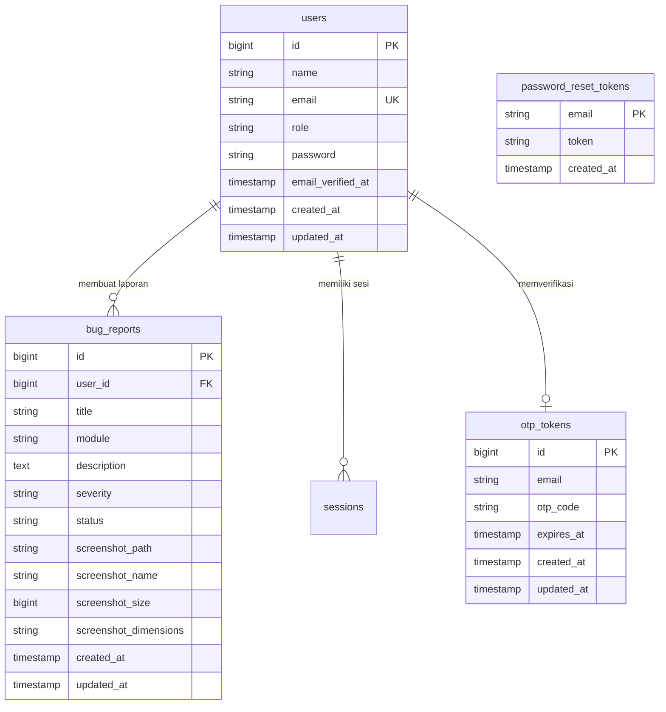

<div align="center">


<p><strong>Platform Manajemen &amp; Pelaporan Bug Berbasis Web dengan Deteksi Duplikasi Cerdas</strong><br>
Solusi pelaporan isu yang terstruktur, bukti visual terintegrasi, dan alur penanganan transparan antara pelapor dan pengembang.</p>

<p>
  
  
  
  
  
  
  
</p>

<p>
  <a href="#fitur">Fitur</a> ·
  <a href="#arsitektur">Arsitektur</a> ·
  <a href="#tech-stack-dan-alasannya">Tech Stack</a> ·
  <a href="#skema-database">Database</a> ·
  <a href="#memulai">Memulai</a> ·
  <a href="#aturan-kontribusi">Kontribusi</a> ·
  <a href="#tim-pengembang">Tim</a>
</p>

</div>

---

**TwinBug** adalah platform pelacak dan pelaporan bug modern berbasis web yang dibangun untuk menjembatani kolaborasi antara penguji perangkat lunak (*Reporter / QA*) dan tim pengembang (*Developer*). Sistem ini dirancang untuk menyelesaikan masalah laporan kendala teknis yang tercecer, format laporan yang tidak seragam, serta pencegahan laporan ganda (*duplicate / twin bug reports*) melalui analisis metadata, konteks semantik, dan bukti tangkapan layar (*screenshot*).

Pengguna dapat:
- Melakukan registrasi mandiri dengan verifikasi kode OTP 6-digit melalui surel resmi;
- Mengirimkan **laporan bug terstruktur** (judul ringkas, modul terdampak, langkah reproduksi, dan tingkat keparahan);
- Melampirkan **bukti tangkapan layar (screenshot)** dengan validasi format dan resolusi otomatis;
- Memantau status penanganan bug secara transparan melalui dashboard real-time;
- Memulihkan akun dengan aman melalui alur lupa kata sandi berbasis token surel.

Tim pengembang (*Developer*) dapat mengelola antrean bug, menganalisis data teknis laporan, serta memperbarui status tindak lanjut bug hingga tuntas.

---

## Daftar Isi

- [Latar Belakang](#latar-belakang)
- [Pengguna](#pengguna)
- [Fitur](#fitur)
- [Alur Pengguna](#alur-pengguna)
- [Arsitektur](#arsitektur)
- [Tech Stack dan Alasannya](#tech-stack-dan-alasannya)
- [Skema Database](#skema-database)
- [Aturan Bisnis](#aturan-bisnis)
- [Target Kinerja](#target-kinerja)
- [Rencana Rilis](#rencana-rilis)
- [Struktur Repo](#struktur-repo)
- [Memulai](#memulai)
- [Aturan Kontribusi](#aturan-kontribusi)
- [Tim Pengembang](#tim-pengembang)

---

## Latar Belakang

Dalam siklus pengembangan perangkat lunak, pelaporan bug sering kali dilakukan secara informal melalui pesan instan, surel, atau spreadsheet tanpa standarisasi. Pola ini memicu sejumlah permasalahan kritis:

- **Laporan bug tidak lengkap:** Langkah reproduksi sering tidak dicantumkan, deskripsi ambigu, dan tidak disertai bukti visual, sehingga pengembang kesulitan mereplikasi masalah.
- **Timbulnya laporan ganda (*twin bugs*):** Beberapa penguji sering kali melaporkan kesalahan yang sama karena tidak adanya sistem yang mendeteksi kemiripan laporan historis.
- **Status penanganan tidak transparan:** Pelapor tidak mengetahui apakah laporan mereka sedang ditelaah, diperbaiki, atau ditolak.
- **Rentan terhadap serangan keamanan:** Sistem autentikasi tanpa pembatasan frekuensi (*rate limiting*) dan verifikasi akun rentan terhadap serangan otomatis / *brute force*.

**TwinBug** hadir untuk menyediakan portal terpusat dengan antarmuka modern, autentikasi terverifikasi OTP, pelaporan terstruktur berparameter keparahan (*severity*), dan lampiran bukti visual terintegrasi.

> **Di luar cakupan versi 1:** Integrasi webhook pihak ketiga (Discord/Slack bot), video screen recording langsung di peramban, multi-tenant per organisasi perusahaan, serta ekspor laporan ke format XLS/PDF tingkat lanjut (direncanakan pada rilis berikutnya).

---

## Pengguna

| Pengguna | Karakteristik | Hak Akses |
|---|---|---|
| **Reporter** | Penguji perangkat lunak, QA, atau pengguna internal yang menemukan kendala teknis dan membutuhkan formulir pelaporan terstandarisasi. | Akses dashboard reporter, membuat laporan bug baru, mengunggah bukti screenshot, melihat histori laporan pribadi. |
| **Developer** | Anggota tim pengembang perangkat lunak yang bertugas menelusuri, mereproduksi, memperbaiki bug, dan memperbarui status pengerjaan. | Akses dashboard pengembang, melihat seluruh antrean bug dalam sistem, menelaah detail dan metadata screenshot, memperbarui status tiket. |
| **Administrator / Scrum Master** | Penanggung jawab sprint dan alur kerja proyek yang memantau metrik performa serta koordinasi tim. | Akses penuh metrik statistik sistem, monitoring pembagian task, dan manajemen pengguna. |

---

## Fitur

Pengembangan modul sistem TwinBug dipetakan berdasarkan kebutuhan fungsional dan backlog sprint.

| Kode | Fitur / Use Case | Pengguna | Ringkasan Fungsional |
|---|---|---|---|
| **F-01** | Registrasi Akun & Verifikasi OTP | Publik | Pendaftaran akun baru dengan pemilihan peran (*Reporter/Developer*), validasi data, dan verifikasi surel menggunakan kode OTP 6-digit. |
| **F-02** | Otentikasi Login Pengguna | Terdaftar | Masuk ke sistem dengan email & password terenkripsi, proteksi *rate limiting*, dan pengalihan ke dashboard peran terkait. |
| **F-03** | Keluar Sistem (Logout) | Pengguna Aktif | Mengakhiri sesi secara aman, invalidasi token sesi, dan regenerasi CSRF token. |
| **F-04** | Buat Laporan Bug (*Create Bug Report*) | Reporter | Formulir terstruktur dengan judul, modul aplikasi, tingkat keparahan (*Low, Medium, High, Critical*), dan langkah reproduksi. |
| **F-05** | Unggah Screenshot Bukti Bug | Reporter | Validasi berkas citra (PNG, JPG, JPEG, GIF, WebP maks. 5MB) dan penyimpanan metadata gambar (*path, filename, size, dimensions*). |
| **F-06** | Pemantauan & Metrik Dashboard | Reporter & Developer | Visualisasi kartu statistik (laporan pribadi, arsip sistem, status akun, tanggal registrasi) dan ringkasan aktivitas terkini. |
| **F-07** | Detail & Penelusuran Laporan Bug | Pengguna Aktif | Melihat rincian deskripsi bug, modul terdampak, status penanganan, serta penampil berkas screenshot lampiran. |
| **F-08** | Pembaruan Status Siklus Hidup Bug | Developer | Mengubah status bug dari tahap pelaporan awal hingga penyelesaian tuntas. |
| **F-13** | Lupa Password & Reset Kata Sandi | Publik | Permintaan tautan/token pemulihan kata sandi via email untuk menyetel ulang kata sandi pengguna terdaftar. |

### Siklus Hidup Status Bug

Status penanganan laporan bug berjalan secara berjenjang dan transparan:

$$\text{Terbuka (Open)} \longrightarrow \text{Diproses (In Progress)} \longrightarrow \text{Diselesaikan (Resolved)} \longrightarrow \text{Ditutup (Closed)}$$

- **Terbuka (*Open*):** Bug baru saja dilaporkan oleh Reporter dan masuk ke dalam antrean review pengembang.
- **Diproses (*In Progress*):** Pengembang sedang menelaah kode, mereproduksi kendala, atau menuliskan patch perbaikan.
- **Diselesaikan (*Resolved*):** Bug telah diperbaiki dan siap diverifikasi ulang di lingkungan pengujian.
- **Ditutup (*Closed*):** Perbaikan bug telah terverifikasi sukses atau dinyatakan selesai.

### Pemetaan Halaman & Rute Aplikasi

| Halaman Antarmuka | Rute URL | Middleware | Use Case |
|---|---|---|---|
| Halaman Depan / Pengalihan | `/` | Web | Pengalihan cerdas ke login atau dashboard |
| Masuk Akun (*Login*) | `/login` | `guest`, `throttle:6,1` | F-02 |
| Pendaftaran Akun (*Register*) | `/register` | `guest`, `throttle:6,1` | F-01 |
| Verifikasi OTP Email | `/otp/verify` | `guest`, `throttle:3,1` | F-01 |
| Status Sukses Verifikasi OTP | `/otp/success` | `guest` | F-01 |
| Permintaan Lupa Kata Sandi | `/forgot-password` | `guest`, `throttle:6,1` | F-13 |
| Formulir Setel Ulang Kata Sandi | `/reset-password/{token}` | `guest` | F-13 |
| Dashboard Utama & Metrik | `/dashboard` | `auth` | F-06 |
| Formulir Buat Laporan Bug Baru | `/bug-reports/create` | `auth` | F-04, F-05 |
| Proses Simpan Laporan Bug | `/bug-reports` `(POST)` | `auth` | F-04, F-05 |
| Keluar Sistem (*Logout*) | `/logout` `(POST)` | `auth` | F-03 |

---

## Alur Pengguna

Pengguna baru mendaftarkan diri, memverifikasi alamat surel dengan kode OTP, masuk ke dashboard, dan membuat laporan bug baru beserta bukti tangkapan layar.



---

## Arsitektur

TwinBug menerapkan arsitektur **Model-View-Controller (MVC)** modern berbasis framework Laravel, yang selaras dengan prinsip **Boundary, Control, Entity (BCE)** untuk memastikan keterpisahan tanggung jawab (*separation of concerns*):

1. **Boundary (Presentation):** Template Blade responsif yang dikompilasi dengan Tailwind CSS v4 dan Vite, dilengkapi komponen UI terisolasi (`<x-layouts>`, `<x-auth.field>`, `<x-auth.icon>`, toast notifikasi).
2. **Control (Application & Logic):** HTTP Routing, Middleware (*Throttle, Guest, Auth, CSRF Verification*), Form Requests dengan validasi ketat (*StoreBugReportRequest, RegisterRequest, LoginRequest*), serta Controller modular.
3. **Entity (Data & Domain):** Model Eloquent (*User, BugReport, OTPToken*) yang merepresentasikan entitas bisnis, didukung migration, relasi integritas referensial, dan PHP 8.3+ Enums berskala kuat (*UserRole, BugSeverity, BugStatus*).
4. **Services & Infrastructure:** Laravel Storage Disk untuk berkas media screenshot publik, dan Mail Transport untuk notifikasi OTP dan token pemulihan kata sandi.



### Pemetaan Boundary, Control, Entity (BCE)

| Lapisan | Komponen di TwinBug | Tanggung Jawab |
|---|---|---|
| **Boundary** | `resources/views/auth/*`, `resources/views/bug-reports/*`, komponen `<x-auth.*>` | Antarmuka pengguna, form input, feedback validasi visual, render styling. |
| **Control** | `AuthenticatedSessionController`, `RegisteredUserController`, `OtpVerificationController`, `BugReportController`, Form Requests | Validasi data, otorisasi peran, penanganan sesi, eksekusi alur use case. |
| **Entity** | `User`, `BugReport`, `OTPToken`, Enums (`UserRole`, `BugSeverity`, `BugStatus`) | Definisi data, aturan integritas skema, relasi database, casting nilai. |

---

## Tech Stack dan Alasannya

| Lapisan | Pilihan | Alasan Pemilihan |
|---|---|---|
| **Framework Backend** | **Laravel (v12/v13)** | Framework PHP tingkat enterprise dengan ekosistem terlengkap: routing tangguh, ORM Eloquent ekspresif, manajemen autentikasi sesi bawaan, sistem migrasi terpadu, dan perlindungan keamanan standar industri (CSRF, XSS, SQL Injection). |
| **Bahasa Pemrograman** | **PHP 8.3+ / 8.5** | Memanfaatkan fitur modern seperti *Typed Properties*, *Constructor Property Promotion*, *Match Expressions*, dan *Backed Enums* yang menjamin konsistensi tipe data di seluruh lapisan sistem. |
| **Frontend & Styling** | **Blade + Tailwind CSS v4** | *Server-rendered UI* yang cepat, efisien, dan ramah SEO. Menggunakan Tailwind CSS v4 berbasis Vite untuk *instant compile* tanpa overhead runtime JavaScript framework yang kompleks. |
| **Build Tooling** | **Vite 8.0** | Bundler ultra cepat yang mengompilasi berkas styling dan skrip antarmuka dengan kapabilitas Hot Module Replacement (HMR). |
| **Database** | **SQLite (Dev/Test) & MySQL/PostgreSQL (Prod)** | Portabilitas tinggi saat pengembangan lokal dan automated testing di CI/CD tanpa dependensi daemon eksternal, dengan dukungan migrasi mudah ke MySQL/Postgres di produksi. |
| **File Storage** | **Laravel Storage (Public Disk Symlink)** | Menyimpan lampiran screenshot bukti bug dengan abstraksi filesystem yang siap dialihkan ke cloud storage (seperti AWS S3 atau MinIO) tanpa mengubah kode controller. |
| **Testing** | **PHPUnit 12 + Laravel Test Suite** | Kerangka uji otomatis untuk memastikan keandalan rute autentikasi, verifikasi OTP, logika penyimpanan pelaporan bug, dan validasi form request. |
| **Code Style Formatter** | **Laravel Pint** | Menjaga konsistensi dan standarisasi gaya penulisan kode PHP tim sesuai panduan PSR-12 dan konvensi Laravel secara otomatis. |
| **CI/CD Pipeline** | **GitHub Actions** | Otomasi pengujian (*automated testing*) dan inspeksi kualitas kode pada setiap *push* dan *pull request* ke branch `main`. |

### Mengapa Laravel, bukan framework lain?

1. **Kecepatan Pengembangan & Stabilitas:** Laravel menyediakan seluruh fondasi yang dibutuhkan (Autentikasi, Enkripsi, Mailer, Migrations, Seeders, Form Requests, File Storage) secara terintegrasi out-of-the-box tanpa perlu merangkai puluhan pustaka terpisah.
2. **Kesesuaian dengan Skala Proyek Sprint:** Arsitektur modular Laravel memungkinkan pembagian tugas tim yang terisolasi dengan rapi antar modul (*feature branching*).
3. **Pengujian Komprehensif Bawaan:** Dukungan *in-memory SQLite database* pada PHPUnit membuat eksekusi testing di lingkungan CI/CD berjalan sangat cepat (< 30 detik).

---

## Skema Database

Skema database dirancang relasional menggunakan Laravel Migrations dengan konvensi penamaan standar dan integritas referensial.

### 1. Akun dan Otentikasi

| Tabel | Kolom Utama | Tipe Data & Constraint | Keterangan |
|---|---|---|---|
| `users` | `id`<br>`name`<br>`email`<br>`role`<br>`password`<br>`email_verified_at`<br>`timestamps` | `BIGINT UNSIGNED AUTO_INCREMENT PK`<br>`VARCHAR(255)`<br>`VARCHAR(255) UNIQUE`<br>`VARCHAR(255) DEFAULT 'reporter'`<br>`VARCHAR(255)`<br>`TIMESTAMP NULL`<br>`TIMESTAMP` | Menyimpan identitas pengguna dan peran (`reporter` atau `developer`). |
| `otp_tokens` | `id`<br>`email`<br>`otp_code`<br>`expires_at`<br>`timestamps` | `BIGINT UNSIGNED AUTO_INCREMENT PK`<br>`VARCHAR(255) INDEX`<br>`VARCHAR(255)`<br>`TIMESTAMP`<br>`TIMESTAMP` | Menyimpan kode OTP 6-digit sementara untuk verifikasi email saat pendaftaran. |
| `password_reset_tokens` | `email`<br>`token`<br>`created_at` | `VARCHAR(255) PK`<br>`VARCHAR(255)`<br>`TIMESTAMP NULL` | Token keamanan bertanda tangan untuk alur pemulihan kata sandi. |
| `sessions` | `id`<br>`user_id`<br>`ip_address`<br>`user_agent`<br>`payload`<br>`last_activity` | `VARCHAR(255) PK`<br>`BIGINT UNSIGNED NULL FK`<br>`VARCHAR(45) NULL`<br>`TEXT NULL`<br>`LONGTEXT`<br>`INT INDEX` | Sesi autentikasi aktif pengguna. |

### 2. Pelaporan Bug

| Tabel | Kolom Utama | Tipe Data & Constraint | Keterangan |
|---|---|---|---|
| `bug_reports` | `id`<br>`user_id`<br>`title`<br>`module`<br>`description`<br>`severity`<br>`status`<br>`screenshot_path`<br>`screenshot_name`<br>`screenshot_size`<br>`screenshot_dimensions`<br>`timestamps` | `BIGINT UNSIGNED AUTO_INCREMENT PK`<br>`BIGINT UNSIGNED FK -> users.id (CASCADE)`<br>`VARCHAR(255)`<br>`VARCHAR(255) NULL`<br>`TEXT`<br>`VARCHAR(255) DEFAULT 'medium'`<br>`VARCHAR(255) DEFAULT 'open'`<br>`VARCHAR(255) NULL`<br>`VARCHAR(255) NULL`<br>`BIGINT UNSIGNED NULL`<br>`VARCHAR(255) NULL`<br>`TIMESTAMP` | Menyimpan seluruh data laporan bug yang dikirimkan, terhubung ke akun pelapor (*user*), beserta metadata lengkap berkas screenshot pendukung. |

### Diagram Entitas Relasi (ERD)



---

## Aturan Bisnis

| Kode | Aturan Bisnis | Implementasi Teknis |
|---|---|---|
| **BR-01** | Registrasi akun baru mewajibkan verifikasi kode OTP 6-digit via surel sebelum data akun resmi diaktifkan. | `RegisteredUserController` menyimpan data sementara di `session`, menerbitkan OTP ke `otp_tokens`, dan `OtpVerificationController` membuat record `User` baru setelah kode cocok. |
| **BR-02** | Masa aktif kode OTP dibatasi maksimal 10 menit dan hanya dapat divalidasi satu kali (*single-use*). | Pengecekan kolom `expires_at > now()`, langsung dihapus (*burned*) seketika setelah verifikasi berhasil. |
| **BR-03** | Proteksi percobaan berulang (*brute-force rate limiting*) pada endpoint otentikasi. | Middleware `throttle:6,1` pada login, registrasi, dan lupa password; serta `throttle:3,1` pada pengiriman kode verifikasi OTP. |
| **BR-04** | Pelaporan bug wajib memuat judul spesifik, deskripsi detail permasalahan/langkah reproduksi, dan tingkat keparahan (*severity*). | Divalidasi secara ketat pada `StoreBugReportRequest` (`required`, `max:255`, valid enum values). |
| **BR-05** | Bukti tangkapan layar wajib berupa citra valid dengan format tertentu dan batasan ukuran berkas. | Aturan validasi: `image`, `mimes:png,jpg,jpeg,gif,webp`, `max:5120` (5MB). Metadata resolusi diekstrak saat berkas disimpan. |
| **BR-06** | Halaman dan aksi pelaporan bug hanya dapat diakses oleh pengguna yang memiliki sesi aktif. | Diproteksi oleh middleware grup `auth`, pengalihan otomatis ke rute `/login` jika sesi belum ada. |
| **BR-07** | Siklus hidup status bug mengikuti transisi berjenjang: `open` $\rightarrow$ `in_progress` $\rightarrow$ `resolved` $\rightarrow$ `closed`. | Dikelola melalui enum `BugStatus` dengan label deskriptif dan validasi pembaruan data oleh developer. |
| **BR-08** | Token pemulihan kata sandi memiliki batas waktu kedaluwarsa 60 menit dan otomatis hangus setelah digunakan. | Dikelola melalui konfigurasi `auth.passwords.users.expire` dan Laravel Password Broker. |

---

## Target Kinerja

| Parameter | Target Metrik | Realisasi Pengujian |
|---|---|---|
| Waktu muat halaman (*Page Load Time*) | $\le 1.5$ detik pada koneksi internet standar | Server-side rendering Blade teroptimasi dan CSS Tailwind terkompilasi |
| Pengiriman formulir laporan bug | $\le 2$ detik | Validasi cepat via Form Request dan Eloquent ORM |
| Unggah dan pemrosesan screenshot 5MB | $\le 3$ detik | Penyimpanan streaming ke local storage disk dengan ekstraksi metadata |
| Pengiriman email verifikasi OTP | $\le 5$ detik | Disalurkan melalui mail transport terkonfigurasi |
| Durasi eksekusi automated test di CI | $\le 2$ menit | Database SQLite in-memory pada GitHub Actions runner |
| Standar Keamanan Aplikasi | Lolos uji CSRF, sanitasi XSS otomatis Blade, dan proteksi SQL Injection | Menggunakan fitur keamanan bawaan framework Laravel |

---

## Rencana Rilis

Pengembangan sistem dibagi menjadi tiga sprint terencana dengan total deliverable fitur fungsional.

> **Sprint Aktif:** **Sprint 1 (Fondasi & Pelaporan Inti)**  
> Tim berfokus menyelesaikan backlog Sprint 1 sesuai dengan pembagian tugas resmi. Modul untuk sprint selanjutnya tidak dikerjakan sebelum sprint aktif diselesaikan dan di-review.

| Sprint | Lingkup Fitur | Fokus Teknis |
|---|---|---|
| **Sprint 1 (Aktif)** | • Setup Inisialisasi Proyek Laravel & CI/CD<br>• F-01 Registrasi Akun & Verifikasi OTP<br>• F-02 Login Pengguna & Keamanan Sesi<br>• F-03 Logout Sistem<br>• F-04 Buat Laporan Bug Baru (*Create Bug Report*)<br>• F-05 Unggah Screenshot Bukti Bug<br>• F-13 Lupa Password & Reset via Email | Fondasi arsitektur MVC, integrasi Tailwind CSS v4, alur autentikasi email OTP, skema database bug report, upload berkas media ke storage, serta GitHub Actions workflow. |
| **Sprint 2** | • F-06 Dashboard Monitoring & Filter Status Bug<br>• F-07 Detail Tampilan Laporan & Preview Bukti Visual<br>• F-08 Penugasan Laporan Bug ke Developer | Filter pencarian bug berdasarkan severity & status, pagination tabel, modal penampil screenshot resolusi penuh, dan alokasi penanganan bug. |
| **Sprint 3** | • F-09 Transisi Siklus Status Bug (Open $\rightarrow$ Closed)<br>• F-10 Diskusi & Catatan Penanganan Bug<br>• F-11 Rekapitulasi & Ekspor Laporan (CSV/PDF) | Histori log perubahan status, formulir tanggapan teknis pengembang, dan generator rekap laporan bug periodik. |

---

## Struktur Repo

```
TwinBug/
├── .github/
│   ├── ISSUE_TEMPLATE/
│   │   └── feature_task.md      # Template pengerjaan issue/fitur sprint
│   └── workflows/
│       └── ci.yml               # GitHub Actions CI automated testing & Pint
├── app/
│   ├── Enums/
│   │   ├── BugSeverity.php      # Enum tingkat keparahan bug (Low, Medium, High, Critical)
│   │   ├── BugStatus.php        # Enum status siklus bug (Open, InProgress, Resolved, Closed)
│   │   └── UserRole.php         # Enum peran pengguna (Reporter, Developer)
│   ├── Http/
│   │   ├── Controllers/
│   │   │   ├── Auth/            # Controller login, register, OTP, dan password reset
│   │   │   └── BugReportController.php # Handler pelaporan bug & upload screenshot
│   │   └── Requests/
│   │       ├── Auth/            # Form validation requests untuk autentikasi
│   │       └── StoreBugReportRequest.php # Form validation pelaporan bug & validasi media
│   ├── Mail/
│   │   └── OtpVerificationCode.php # Mailable template email pengiriman kode OTP
│   └── Models/
│       ├── BugReport.php        # Model pelaporan bug & relasi user
│       ├── OTPToken.php         # Model token OTP verifikasi email
│       └── User.php             # Model data pengguna
├── bootstrap/                   # Inisialisasi framework & routing middleware
├── config/                      # Konfigurasi aplikasi, mail, database, & auth
├── database/
│   ├── factories/               # Model factories untuk testing
│   ├── migrations/              # Berkas migrasi skema tabel database
│   └── seeders/                 # Seeder data pengguna demo
├── docs/
│   └── SPRINT_1_ISSUES.md       # Dokumentasi resmi issue & pembagian task Sprint 1
├── public/                      # Entry point publik (index.php) & aset terkompilasi
├── resources/
│   ├── css/                     # Berkas Tailwind CSS v4
│   ├── js/                      # Berkas skrip Vite JavaScript
│   └── views/
│       ├── auth/                # Halaman antarmuka login, register, OTP, & reset kata sandi
│       ├── bug-reports/         # Halaman formulir pelaporan bug & komponen uploader
│       ├── components/          # Komponen reusable Blade (layout, field, icon, toast)
│       ├── emails/              # Template konten HTML email OTP
│       └── dashboard.blade.php  # Dashboard metrik & monitoring aktivitas
├── routes/
│   └── web.php                  # Definisi rute web & middleware grouping
└── tests/
    ├── Feature/
    │   ├── BugReportTest.php       # Uji fitur pembuatan laporan bug & otorisasi
    │   └── RegistrationOtpTest.php # Uji fitur alur pendaftaran akun & verifikasi OTP
    └── TestCase.php
```

---

## Memulai

### Prasyarat Sistem

Pastikan lingkungan lokal Anda telah terpasang:
- **PHP $\ge$ 8.3** (dengan ekstensi `pdo_sqlite` atau `pdo_mysql`, `mbstring`, `fileinfo`, `openssl`, `curl`)
- **Composer 2.x**
- **Node.js $\ge$ 20.x** & **npm**
- **Git**

### Langkah Instalasi

1. **Kloning Repositori:**
   ```bash
   git clone https://github.com/AgilePemdigi-2026/TwinBug.git
   cd TwinBug
   ```

2. **Pasang Dependensi PHP:**
   ```bash
   composer install
   ```

3. **Pasang Dependensi Frontend & Kompilasi Aset:**
   ```bash
   npm install
   npm run build
   ```

4. **Konfigurasi Environment:**
   Salin berkas konfigurasi `.env.example` menjadi `.env`:
   ```bash
   # Di Windows PowerShell:
   Copy-Item .env.example .env

   # Di Linux / macOS:
   cp .env.example .env
   ```

5. **Generate Kunci Aplikasi:**
   ```bash
   php artisan key:generate
   ```

6. **Persiapan Database & Migrasi Skema:**
   Secara default, TwinBug menggunakan SQLite. Pastikan berkas basis data tersedia lalu jalankan migrasi:
   ```bash
   # Membuat berkas database sqlite jika belum ada:
   # PowerShell:
   if (-not (Test-Path database/database.sqlite)) { New-Item database/database.sqlite -ItemType File }
   # Bash:
   touch database/database.sqlite

   # Jalankan migrasi:
   php artisan migrate
   ```

7. **Buat Symlink Storage Publik:**
   Langkah ini wajib agar berkas screenshot bukti bug dapat diakses secara publik oleh peramban:
   ```bash
   php artisan storage:link
   ```

8. **Menjalankan Server Pengembangan:**
   Jalankan server aplikasi Laravel dan bundler Vite secara bersamaan:
   ```bash
   # Terminal 1 (Backend Laravel):
   php artisan serve

   # Terminal 2 (Frontend Vite HMR):
   npm run dev
   ```
   Aplikasi dapat diakses melalui peramban di: `http://localhost:8000` (atau port yang tertera pada terminal).

---

### Perintah Penting Pengembangan

| Perintah | Fungsi |
|---|---|
| `php artisan serve` | Menjalankan web server lokal Laravel |
| `npm run dev` | Menjalankan Vite dev server untuk live preview antarmuka |
| `npm run build` | Melakukan kompilasi aset frontend untuk produksi |
| `php artisan test` | Menjalankan automated test suite (PHPUnit) |
| `vendor/bin/pint --format agent` | Memeriksa dan merapikan format kode PHP sesuai standar tim |
| `php artisan migrate:fresh` | Mengatur ulang seluruh tabel basis data dari awal |
| `php artisan storage:link` | Membuat tautan simbolik direktori storage ke direktori publik |

---

### Akun Demo untuk Pengujian Antarmuka

Untuk kemudahan demonstrasi tanpa harus melakukan registrasi manual, sistem menyediakan tombol akses cepat pada halaman login dengan kredensial pengujian berikut:

| Peran Akun | Alamat Surel | Kata Sandi | Deskripsi Akses |
|---|---|---|---|
| **Reporter** | `reporter.demo@gmail.com` | `TwinBug@Demo2025!` | Mengakses dashboard pelapor, membuat laporan bug, dan mengunggah screenshot. |
| **Developer** | `developer.demo@gmail.com` | `TwinBug@Demo2025!` | Mengakses dashboard pengembang dan memantau seluruh antrean isu teknis. |

---

## Aturan Kontribusi

Seluruh anggota tim wajib mematuhi pedoman kerja sama repositori untuk menjamin keteraturan kode:

1. **Alur Pengerjaan Branch:**
   - Gunakan pola penamaan branch: `<tipe>/<kode-fitur>-<deskripsi-singkat>`
   - Contoh: `feat/f-04-create-bug-report`, `fix/f-01-otp-expiry`, `chore/ci-workflow`
   - Branch `main` bersifat terlindungi (*protected*) dan perubahan hanya digabungkan melalui **Pull Request (PR)**.

2. **Konvensi Pesan Commit:**
   - Terapkan standar *Conventional Commits*:
     - `feat(f-04): add bug report creation form and validation`
     - `fix(auth): correct otp expiry check logic`
     - `test(feature): add automated tests for screenshot upload`
     - `docs(readme): update project documentation and setup guide`

3. **Standar Kode & Pemformatan:**
   - Selalu jalankan `vendor/bin/pint --format agent` sebelum melakukan commit kode PHP.
   - Pastikan seluruh pengujian lokal lulus dengan menjalankan `php artisan test`.

4. **Keamanan Kredensial:**
   - Jangan pernah menyertakan kredensial rahasia, kata sandi email, API keys, atau berkas `.env` asli ke dalam commit repositori Git.

5. **Kesesuaian Sprint:**
   - Setiap Pull Request wajib mencantumkan nomor Issue/Task yang relevan dari [docs/SPRINT_1_ISSUES.md](docs/SPRINT_1_ISSUES.md) dan mengisi checklist kriteria pengujian.

---

## Tim Pengembang

Proyek ini dikembangkan oleh mahasiswa Program Studi S1 Sistem Informasi, Fakultas Sains dan Teknologi, Universitas Airlangga dalam mata kuliah **Praktikum Pengembangan Perangkat Lunak Agile (Agile Pemdigi 2026)**:

| Nama Lengkap | NIM | GitHub | Peran & Tanggung Jawab Proyek |
|---|---|---|---|
| **Abdul Hakim Fatur Rochman** | 187241111 | [@AbdulHakimFaturR](https://github.com/AbdulHakimFaturR) | **Scrum Master / Project Lead**<br>• Koordinasi Sprint & Monitoring Fitur (`#2`)<br>• Fitur Upload Screenshot Bukti Bug (`#8`, `F-05`) |
| **Ivan Raditya Prisetyo** | 187241072 | [@Ivan-Raditya](https://github.com/Ivan-Raditya) | **Fullstack Developer & CI/CD Specialist**<br>• Fitur Buat Laporan Bug (`#1`, `F-04`)<br>• Integrasi UI/UX & Styling (`#9`)<br>• Konfigurasi GitHub Actions CI (`#10`) |
| **Isa Jahwa Fatimiyah** | 187241029 | [@isajahwa](https://github.com/isajahwa) | **Frontend & Auth Developer**<br>• Fitur Registrasi Akun & Verifikasi OTP (`#3`, `F-01`)<br>• Fitur Keluar Sistem / Logout (`#4`, `F-03`) |
| **Muhammad Fikhlas Hakim Arya Maulana** | 187241034 | [@fikhlassm](https://github.com/fikhlassm) | **Backend & Security Developer**<br>• Otentikasi Login Pengguna (`#5`, `F-02`)<br>• Fitur Lupa & Reset Password (`#6`, `F-13`)<br>• Setup Fondasi Proyek Laravel (`#7`) |

---

<div align="center">
  <br>
  <sub><strong>TwinBug</strong> · Kelompok Praktikum Agile Pemdigi 2026<br>
  Program Studi S1 Sistem Informasi · Fakultas Sains dan Teknologi · Universitas Airlangga</sub>
</div>
